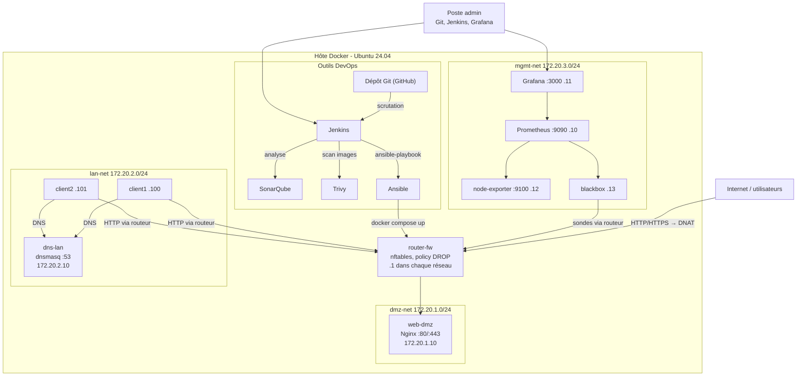

# Architecture technique

## Schéma

## Choix techniques

| Sujet | Choix | Justification |
|---|---|---|
| Système hôte | Ubuntu 24.04 LTS | Noyau récent (nftables complet), support jusqu'en 2029 |
| Isolation des zones | 3 réseaux bridge Docker, passerelle Docker en `.254` | Le `.1` est laissé au routeur, comme sur le schéma du sujet |
| Routage inter-zones | Chaque conteneur a sa route par défaut vers `router-fw` (variable `NET_ROUTES`) | Tout le trafic inter-zones traverse le pare-feu |
| Pare-feu | nftables, chaînes `input` et `forward` en `policy drop` | « Tout est interdit sauf ce qui est autorisé » |
| Exposition Internet | Ports 80/443 publiés sur `router-fw`, puis DNAT vers `web-dmz` | Le serveur web n'est jamais exposé directement |
| Configuration | Ansible génère toutes les configurations (nftables, dnsmasq, Nginx, Prometheus, Compose) depuis des variables | Une seule source de vérité : `playbooks/group_vars/all/common.yml` |
| Environnements | Test (172.21.x) et prod (172.20.x) générés par les mêmes rôles | On teste exactement ce qui part en production, sur le même hôte |
| Secrets | Ansible Vault ; mot de passe fourni par un credential Jenkins | Aucun secret en clair dans Git |
| Supervision | Prometheus + node-exporter + blackbox exporter, Grafana provisionné | Les sondes blackbox passent par le pare-feu : elles vérifient les flux réels |

## Flux d'un déploiement

1. Un `git push` sur `main` est détecté par Jenkins (scrutation toutes les 5 minutes).
2. Jenkins lance le lint, puis l'analyse SonarQube.
3. Ansible génère les configurations de **test** et construit les 4 images, étiquetées avec le numéro de build.
4. Trivy analyse les images ; une CVE critique corrigeable bloque le pipeline.
5. Ansible déploie l'environnement de test et attend que router-fw, web-dmz et dns-lan soient *healthy*.
6. `tests/connectivity_test.py` vérifie toute la matrice des flux, puis l'environnement de test est supprimé.
7. Ansible déploie la **production** avec les mêmes images, puis les tests sont rejoués sur la prod.
8. En cas d'échec à n'importe quelle étape, un email est envoyé.
